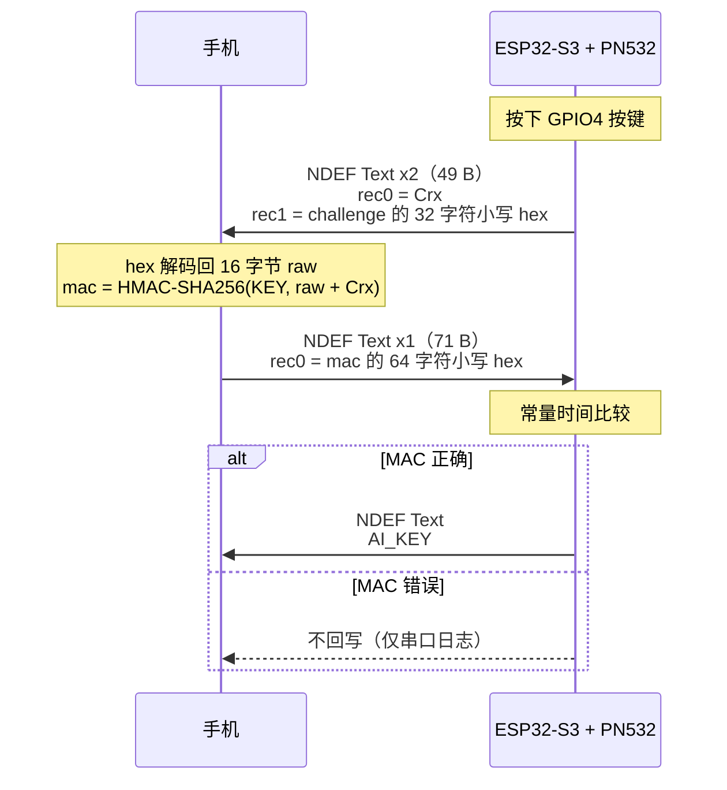

# CrX-AI-assistant

ESP32-S3 + PN532 的 NFC 认证取密钥设备：PN532 以 SNEP target 方式模拟一张 NFC 卡，按一下按键发起一轮挑战-应答，手机用 HMAC-SHA256 证明自己持有共享密钥，通过后设备把 AI API Key 以 NDEF 明文回写给手机。

> ⚠️ **当前是原型，不可用于生产。** `SHARED_KEY` 是公开测试向量 `00 01 … 0f`，`AI_KEY` 明文硬编码在固件里。
> 详见 [SECURITY-REVIEW.md](./SECURITY-REVIEW.md)。

本仓库只有设备端固件。手机端 App 不在其中，需按下方「协议」自行实现。

## 硬件

| 项目 | 说明 |
|---|---|
| 主控 | ESP32-S3（FQBN `esp32:esp32:esp32s3`，`FlashSize=16M`） |
| NFC | PN532 模块，**DIP 拨到 SPI** |
| 接线 | SCK=GPIO12、MISO=GPIO13、MOSI=GPIO11（S3 默认 FSPI）、SS=GPIO15 |
| 触发 | 按键一端接 GPIO4，一端接 GND（内部上拉，下降沿中断） |

> ESP32-S3 没有 GPIO22~25，按键只能选 0~21 / 26~48 里的空闲脚。

## 使用

设备是 **SNEP target**（被动方）：`SNEP::write()` 内部先 `llcp.activate()` 再 `llcp.connect()`，等手机来发起连接。
所以手机端必须处于**主动读卡**状态（Android 的 reader mode / `enableReaderMode`，或 iOS 的 `NFCTagReaderSession`），
不能只是把手机贴上去等设备推数据。

1. 上电，串口 115200 看 `[OK] PN532 firmware = 0x...`，确认 PN532 正常。
2. 手机 App 进入读卡界面，贴到 PN532 天线上。
3. 按一下 GPIO4 按键，设备发 challenge。
4. App 算 MAC 回写，设备校验通过后回写 AI Key，串口打印 `[OK] AUTH OK`。

## 协议

设备与手机之间只走 NDEF Text 记录，没有额外封装。



要点：

* MAC 的输入是**原始 16 字节** challenge，不是那 32 个 hex 字符。手机端忘记先 hex 解码是本协议最容易踩的坑。
* 拼接方式是 `rawChallenge` 后接 `"Crx"`，无分隔符、无长度前缀。
* 设备只接受「单条记录 + MB/ME/SR 全置位」的回包（`data[0] & 0xD0 == 0xD0`），分片或长记录写法会被拒绝，只在串口留一行 `[FAIL]`。
* 单次事务最坏阻塞约 3 s（write）+ 5 s × 2（read 内部先 activate 再 waitForConnection），且没有看门狗。

## 目录结构

```
AI_KEY_v3/AI_KEY_v3.ino   当前版本，唯一可编译的 sketch
AI_KEY.ino                v1，历史版本
AI_KEY_v2.ino             v2，历史版本
BUILD.md                  编译说明（离线 arduino-cli 方案）
SECURITY-REVIEW.md        代码审计报告
arduino-cli.yaml          arduino-cli 配置，指向本机离线工具链
.vscode/tasks.json        编译 / 上传 / 清理 / 刷新 IntelliSense 任务
.vscode/gen-intellisense.ps1  生成 c_cpp_properties.json
.vscode/c_cpp_properties.json 生成物，勿手改
lib/                      PlatformIO 遗留的新版 Seeed 库，当前编译不读，可删
```

`AI_KEY.ino` 与 `AI_KEY_v2.ino` 是散文件。arduino-cli 要求 `名字\名字.ino` 结构，且同一目录下只能有一个主 `.ino`（Arduino 会把目录里所有 `.ino` 合并编译，多个 `setup()`/`loop()` 会重复定义），所以它们不能直接编译，只作历史参考。

## 编译与烧录

需要离线工具链：arduino-cli 1.6.0 + esp32 core 3.3.11 + `PN532-arduino` / `NDEF` 旧版库。路径见 [arduino-cli.yaml](./arduino-cli.yaml)。

VS Code 里 `Ctrl+Shift+B` 即可。命令行：

```powershell
e:\ExtraAppsHDD\arduino-cli.exe --config-file arduino-cli.yaml compile `
  --fqbn esp32:esp32:esp32s3:FlashSize=16M `
  --build-path build\AI_KEY_v3 AI_KEY_v3

e:\ExtraAppsHDD\arduino-cli.exe --config-file arduino-cli.yaml upload `
  --fqbn esp32:esp32:esp32s3:FlashSize=16M --build-path build\AI_KEY_v3 COM5
```

产物全部落在仓库内的 `build\`（已 gitignore）。**不要加 `--output-dir` 或 `-e`**，否则 esp32 core 的 `savehex` 钩子会往 sketch 目录里再复制一份。

完整说明、IntelliSense 配置原理、库版本兼容坑见 [BUILD.md](./BUILD.md)。

## 串口输出

115200 8N1。上电自检 PN532 固件版本，之后每次按键打印一轮：

```
AI_KEY v3 boot
[OK] PN532 firmware = 0x00000000
[READY] 按 GPIO4 触发一次认证
[TX] uid=Crx challenge=<32 hex>
[OK] AUTH OK: 对端持有共享密钥
```

## 安全状态

| 问题 | 严重度 |
|---|---|
| `SHARED_KEY` 硬编码且为公开测试向量，认证形同虚设 | 🔴 CRITICAL |
| `AI_KEY` 长期密钥明文存于固件，认证通过后明文下发 | 🔴 CRITICAL |
| 协议无机密性、无会话绑定，可重放 | 🟠 HIGH |

修复方向与逐条代码位置见 [SECURITY-REVIEW.md](./SECURITY-REVIEW.md)。

## 许可

仓库暂未附带 LICENSE 文件。
